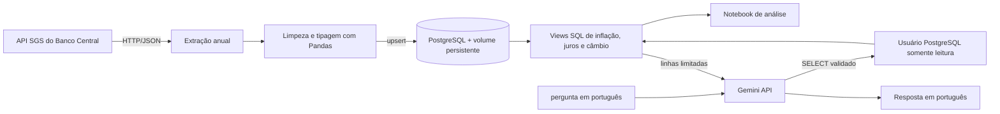
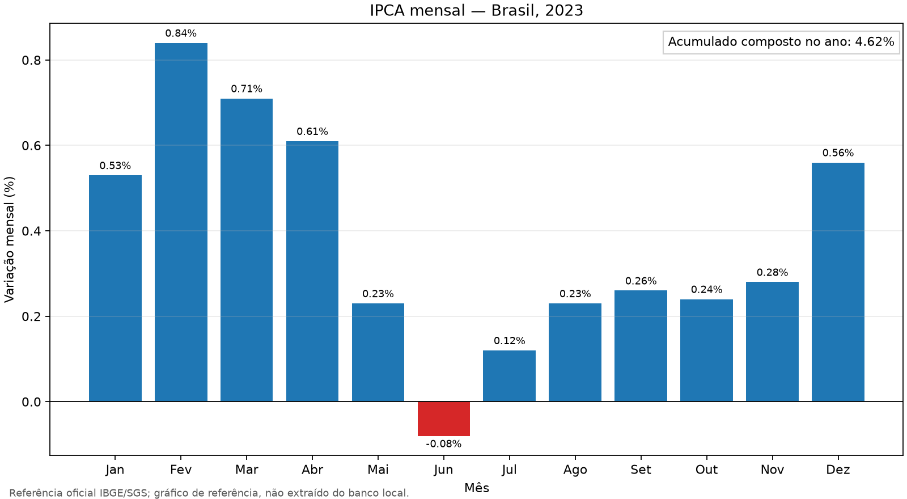

# Economia BR: séries, análises e perguntas com IA

Pipeline de dados econômicos brasileiros que extrai séries do Banco Central,
transforma e persiste observações em PostgreSQL, calcula métricas de inflação e
juros e permite consultá-las em português usando Gemini text-to-SQL.

> **Estado dos dados:** os resultados dependem da carga SGS no banco local. O
> gráfico deste README usa referências oficiais publicadas para 2023 e está
> explicitamente identificado como referência, não como resultado do banco.

## Problema e solução

Dados de inflação, juros e câmbio estão disponíveis em séries diferentes e não
são diretamente comparáveis. Este projeto automatiza a extração e carga
incremental, consolida as métricas em views SQL e oferece uma interface
experimental de perguntas em linguagem natural, restrita a consultas de leitura.



## Stack

- Python 3.12; `requests`, Pandas e NumPy para extração e transformação.
- PostgreSQL 16 em Docker Compose, SQLAlchemy e psycopg2.
- SQL para persistência e views; Jupyter e Matplotlib para análise.
- Google Gemini API para geração e explicação de consultas; SQLGlot para validar SQL.
- pytest para os testes de transformação e da aplicação.

## Começar no Windows

Pré-requisitos: Docker Desktop com o engine Linux iniciado, Python 3.12 e
PowerShell. O setup local e a execução de um teste devem levar alguns minutos;
a primeira extração depende da disponibilidade e velocidade da API do BCB.

Clone o repositório e entre na pasta:

```powershell
git clone https://github.com/GabrielSorge/Projeto-economia-br.git
Set-Location Projeto-economia-br
```

### 1. Instalar dependências

Na raiz do repositório:

```powershell
py -3.12 -m venv .venv
.\.venv\Scripts\Activate.ps1
python -m pip install -r requirements-dev.txt
```

Se a ativação da venv estiver bloqueada pela política do PowerShell, execute
`.\.venv\Scripts\python.exe` no lugar de `python`.

### 2. Configurar ambiente local

```powershell
Copy-Item .env.example .env
```

Abra `.env` e preencha `POSTGRES_PASSWORD` e
`POSTGRES_READONLY_PASSWORD` com senhas locais diferentes. Gere uma senha aleatória
com:

```powershell
python -c "import secrets; print(secrets.token_urlsafe(24))"
```

Para a integração Gemini, crie uma chave no
[Google AI Studio](https://aistudio.google.com/apikey) e preencha `GEMINI_API_KEY`.
Sem a chave, o pipeline e o notebook continuam disponíveis, mas as perguntas
em linguagem natural ficam desabilitadas. Nunca envie `.env` ou a chave para o Git.

### 3. Subir PostgreSQL e usuário de leitura

```powershell
docker compose up -d postgres db-setup
docker compose ps
```

O healthcheck espera o PostgreSQL ficar pronto. `db-setup` cria/atualiza o usuário
de leitura e libera `SELECT` somente nas views de análise. Os dados ficam no
volume nomeado `postgres_data`.

### 4. Executar pipeline e verificar

```powershell
docker compose up --build
```

O pipeline extrai por padrão as séries `432,11,12,433,1`, desde `01/01/2020`.
Configure `SERIES_CODES` e `DATA_INICIAL` em `.env` para reduzir o primeiro teste
ou escolher outro período. A API SGS pode estar indisponível ou limitar consultas;
nesse caso, os erros aparecem nos logs e uma nova tentativa pode ser feita com o
mesmo comando. O upsert permite executar novamente sem duplicar observações.

Confira o estado e os logs:

```powershell
docker compose ps
docker compose logs pipeline
```

O container `pipeline` termina após completar a carga; isso é esperado. Para
executá-lo novamente, use `docker compose run --build --rm pipeline`.

### 5. Executar testes

```powershell
python -m pytest
```

## Executar análises

Abra `notebooks/analise.ipynb` no VS Code/Jupyter e execute as células em ordem.
O notebook aplica `sql/02_views.sql`, consulta as views no PostgreSQL, compara
o IPCA acumulado de 2023 com a referência IBGE de 4,62%, calcula a correlação
entre a variação mensal do câmbio e o IPCA mensal, e desenha gráficos rotulados.
Sem histórico carregado, as consultas ficam vazias e o notebook explica a
limitação em vez de inventar resultados.

### Referência oficial do IPCA mensal — 2023

O gráfico abaixo mostra as taxas mensais oficiais de 2023. A composição
geométrica dos 12 valores resulta em 4,62111%, que arredonda para os 4,62%
publicados pelo IBGE. É uma validação de referência da fórmula, não uma captura
de uma execução com dados do banco local.



Para regenerar o gráfico: `python scripts/gerar_grafico_ipca_referencia.py`.

Fonte: [IBGE — IPCA de dezembro de 2023 e resultado anual](https://agenciadenoticias.ibge.gov.br/agencia-sala-de-imprensa/2013-agencia-de-noticias/releases/38984-ipca-vai-a-0-56-em-dezembro-e-fecha-o-ano-em-4-62).

## Perguntar aos dados com Gemini

Com `.env` configurado, PostgreSQL ativo, role de leitura criada e séries
carregadas:

```powershell
python -m src.text_to_sql "Qual foi o juro real médio em 2023?"
```

O prompt fornece à IA as colunas, unidades e um exemplo. Antes da execução, a
consulta precisa passar por estas barreiras:

- Uma única instrução `SELECT`, validada pelo parser SQLGlot.
- Somente as views `vw_ipca_12_meses`, `vw_juro_real` e `vw_analise_mensal`.
- Funções permitidas, máximo de 100 linhas e timeout de 5 segundos.
- Transação PostgreSQL explicitamente somente leitura e credencial sem acesso às
  tabelas-base ou escrita.
- No máximo uma tentativa de correção quando o PostgreSQL rejeita o SQL.

A pergunta, a consulta e no máximo 20 linhas de resultado são enviadas ao Google
para produzir a resposta. Não use com informações confidenciais. A resposta
depende dos dados presentes no banco; sem carga de dados, não há valor real a
responder. Não há captura de uma resposta Gemini incluída: ela requer uma chave
local e dados carregados, e não deve ser simulada como resultado real.

### Perguntas de referência

| Pergunta | View/colunas | Interpretação |
|---|---|---|
| Qual foi o juro real médio em 2023? | `vw_juro_real.juro_real_pct` | Média de janeiro a dezembro, em % a.a. |
| Qual foi a maior inflação acumulada em 12 meses? | `vw_ipca_12_meses.inflacao_12_meses_pct` | Máximo no intervalo disponível, em %. |
| Qual foi o câmbio médio em 2023? | `vw_analise_mensal.cambio_medio_brl_por_usd` | Média em BRL por USD. |

## Esquema e convenções

- `series_catalogo`: código SGS e descrição.
- `series_valores`: código, data e valor; chave primária composta `(codigo, data)`.
- Série 433: IPCA mensal, percentagem.
- Série 12: Selic anual, percentagem ao ano.
- Série 1: câmbio, BRL por USD.
- `vw_ipca_12_meses`: produto composto de 12 variações mensais do IPCA.
- `vw_juro_real`: equação de Fisher com a última Selic observada no mês e inflação
  acumulada. É uma aproximação ex-post, não a taxa real esperada.
- `vw_analise_mensal`: câmbio médio e variação mensal, IPCA e juro real.

A relação entre câmbio e inflação é uma correlação descritiva. Correlação não
prova causalidade e não controla por defasagens, política monetária ou choques
externos.

## Limitações e segurança

- A primeira carga precisa consultar a API externa do BCB e pode demorar ou falhar
  por timeout, limites do endpoint ou conectividade.
- A carga incremental começa na data máxima existente e reconsulta essa data
  para atualizar observações revisadas.
- Scripts em `docker-entrypoint-initdb.d` só rodam na criação inicial do volume.
  `db-setup` é executado pelo Compose para atualizar permissões.
- A chave Gemini é usada localmente pelo cliente e nunca deve ser commitada.
  No nível gratuito, limites, modelos disponíveis e tratamento dos dados enviados
  seguem as condições atuais do Google.
- O pipeline precisa de credencial de escrita; o text-to-SQL usa uma credencial
  distinta, sem escrita.

## Testes

`python -m pytest` executa os testes de transformação, carga, orquestração,
validação de SQL e tratamento de erros. As chamadas à Gemini são simuladas nos
testes; nenhuma chave ou chamada paga é necessária para rodá-los.

## Histórico e divulgação

O histórico atual contém commits separados para configuração inicial, extração,
testes, análise e text-to-SQL. Não reescreva commits publicados para melhorar
mensagens antigas; mantenha mensagens concisas e específicas nos próximos commits.
