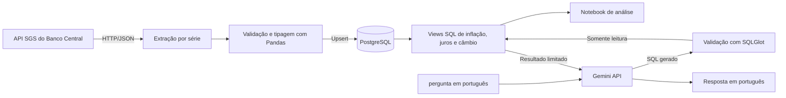

# Economia BR

[](https://github.com/GabrielSorge/Projeto-economia-br/actions/workflows/ci.yml)

Pipeline de dados econômicos brasileiros que coleta séries do Banco Central,
organiza observações no PostgreSQL e disponibiliza análises em SQL, notebook e
linguagem natural.

O projeto demonstra um fluxo de engenharia de dados de ponta a ponta: extração
de API, transformação com Python e Pandas, carga incremental, modelagem em SQL,
testes automatizados e consultas com acesso somente leitura.

> **Dados:** as consultas e análises dependem de uma carga executada no banco
> local. O gráfico de referência abaixo usa dados oficiais publicados pelo IBGE
> para 2023; não representa uma execução do pipeline.

## Visão geral



### O que o projeto faz

- Consulta séries SGS do Banco Central com requisições HTTP e valida as respostas.
- Limpa, tipa e deduplica observações com Pandas antes da carga.
- Carrega dados no PostgreSQL com upsert e processamento incremental.
- Calcula métricas mensais em views SQL, mantendo as observações originais na
  tabela de valores.
- Permite explorar as métricas em notebook ou fazer perguntas em português com
  Gemini, usando uma credencial PostgreSQL somente leitura.
- Isola falhas por série, registra erros e encerra com status diferente de zero
  se alguma série não puder ser processada.

## Séries e métricas

Os códigos, descrições, unidades e periodicidades abaixo foram conferidos no
SGS. A seleção padrão do pipeline é `432,11,433,1`.

| Código | Série | Unidade | Periodicidade |
|---:|---|---|:---:|
| 432 | Meta Selic definida pelo Copom | `% a.a.` | Diária |
| 11 | Taxa de juros - Selic | `% a.d.` | Diária |
| 12 | Taxa de juros - CDI | `% a.d.` | Diária |
| 433 | IPCA | Variação percentual mensal | Mensal |
| 1 | Câmbio - dólar americano (venda) | `u.m.c./US$` | Diária |

A série 12 representa o CDI diário, não uma taxa anual. Por isso, a view
`vw_juro_real` usa a Meta Selic anual da série 432. A taxa real é calculada pela
equação de Fisher com a última observação da Meta Selic disponível em cada mês e
a inflação acumulada em 12 meses. É uma aproximação ex-post, não uma expectativa
de mercado.

As principais views são:

- `vw_ipca_12_meses`: composição geométrica das 12 variações mensais do IPCA.
- `vw_juro_real`: Meta Selic anual, inflação acumulada em 12 meses e juro real.
- `vw_analise_mensal`: câmbio médio, variação mensal do câmbio, IPCA mensal e
  juro real.

A agregação mensal é feita nas views SQL (ELT: os dados são extraídos e
carregados antes de serem transformados no banco). A correlação entre câmbio e
IPCA é descritiva e não demonstra causalidade.

## Tecnologias

- Python 3.12, Pandas, NumPy e Requests.
- PostgreSQL 16, SQLAlchemy e psycopg2.
- Docker Compose para os serviços locais.
- SQLGlot para validar as consultas text-to-SQL.
- Gemini API para geração de consultas e respostas em linguagem natural.
- pytest e GitHub Actions para testes e integração contínua.

## Executar localmente

Instruções para Windows, PowerShell e Docker Desktop com o engine Linux ativo.

### 1. Clonar e instalar dependências

```powershell
git clone https://github.com/GabrielSorge/Projeto-economia-br.git
Set-Location Projeto-economia-br

py -3.12 -m venv .venv
.\.venv\Scripts\Activate.ps1
python -m pip install -r requirements-dev.txt
```

Se a ativação do ambiente virtual estiver bloqueada pela política do PowerShell,
use `.\.venv\Scripts\python.exe` no lugar de `python`.

### 2. Configurar variáveis de ambiente

```powershell
Copy-Item .env.example .env
```

No arquivo `.env`, defina `POSTGRES_PASSWORD` e
`POSTGRES_READONLY_PASSWORD` com senhas locais diferentes. Para gerar uma senha:

```powershell
python -c "import secrets; print(secrets.token_urlsafe(24))"
```

As perguntas em linguagem natural também exigem uma chave do
[Google AI Studio](https://aistudio.google.com/apikey), definida em
`GEMINI_API_KEY`. Essa chave é opcional para executar o pipeline e o notebook.
Não compartilhe nem versione o arquivo `.env`.

### 3. Iniciar o banco

```powershell
docker compose up -d postgres db-setup
docker compose ps
```

O Compose inicia o PostgreSQL, aplica os scripts SQL e configura a credencial
de leitura usada pela interface text-to-SQL. Os dados são armazenados no volume
persistente `postgres_data`.

### 4. Executar a carga

```powershell
docker compose up --build pipeline
```

Por padrão, o pipeline consulta as séries `432,11,433,1` desde `01/01/2020`.
Ajuste `SERIES_CODES` e `DATA_INICIAL` no `.env` para escolher outras séries ou
reduzir o período inicial.

O processamento é incremental: a próxima consulta começa na data mais recente já
carregada, inclusive, para permitir a atualização de observações revisadas. O
upsert insere ou atualiza registros pela chave `(codigo, data)`, evitando
duplicatas em novas execuções.

Confira o resultado:

```powershell
docker compose logs pipeline
docker compose ps
```

O container termina ao concluir a carga. Para executá-la novamente:

```powershell
docker compose run --build --rm pipeline
```

O log final apresenta quantas séries tiveram sucesso ou falha e quantas linhas
foram carregadas. Se alguma série falhar, o processo retorna código diferente de
zero para que Docker e CI sinalizem a execução.

## Análises no notebook

Abra [`notebooks/analise.ipynb`](notebooks/analise.ipynb) no VS Code ou Jupyter e
execute as células em ordem. O notebook aplica as views SQL, consulta os dados
no PostgreSQL e apresenta as métricas e gráficos. A comparação do IPCA de
dezembro de 2023 com os 4,62% publicados pelo IBGE só é concluída quando há dados
carregados para o período.

### Referência oficial do IPCA de 2023

O gráfico apresenta taxas mensais oficiais de 2023. A composição geométrica dos
12 valores resulta em 4,62111%, que arredonda para os 4,62% publicados pelo
IBGE. É uma referência para a fórmula, não um resultado do banco local.


Para regenerar o gráfico: `python scripts/gerar_grafico_ipca_referencia.py`.

Fonte: [IBGE — IPCA de dezembro de 2023 e resultado anual](https://agenciadenoticias.ibge.gov.br/agencia-sala-de-imprensa/2013-agencia-de-noticias/releases/38984-ipca-vai-a-0-56-em-dezembro-e-fecha-o-ano-em-4-62).

## Perguntas em linguagem natural

Com o PostgreSQL ativo, as séries carregadas e `GEMINI_API_KEY` definida:

```powershell
python -m src.text_to_sql "Qual foi o juro real médio em 2023?"
```

O sistema usa o Gemini para gerar SQL PostgreSQL e explicar o resultado. Antes
da execução, a consulta passa por validações:

- Apenas uma instrução `SELECT` sobre as views de análise autorizadas.
- Lista de funções permitidas e limite de 100 linhas.
- Transação PostgreSQL somente leitura e timeout de cinco segundos.
- No máximo uma tentativa de correção quando o banco rejeita a consulta.

A pergunta, o SQL e até 20 linhas de resultado são enviados ao Google para gerar
a resposta. Não use essa funcionalidade com informações confidenciais. Sem
chave de API ou dados carregados, não há resposta baseada em dados reais.

## Testes e integração contínua

Execute os testes locais com:

```powershell
python -m pytest
```

O GitHub Actions executa os testes em push e pull request usando Python 3.12.
O workflow também inicia um PostgreSQL temporário para validar as views com
dados sintéticos. Localmente, o teste de integração é ignorado se
`TEST_DATABASE_URL` não estiver definida. As chamadas à Gemini são simuladas;
não é necessária uma chave de API para a suíte.

## Estrutura do repositório

```text
.
├── .github/workflows/ci.yml   # Testes automatizados
├── ia/perguntas.py            # Interface de perguntas em linguagem natural
├── notebooks/analise.ipynb    # Análises e visualizações
├── sql/                       # Tabelas, views e permissões
├── src/                       # Extração, transformação, carga e aplicação
├── tests/                     # Testes unitários e de integração
├── docker-compose.yml         # PostgreSQL e pipeline
└── requirements*.txt          # Dependências Python
```

## Limitações e segurança

- A disponibilidade e os limites da API SGS podem afetar a primeira carga.
- O pipeline precisa de credencial de escrita; as perguntas text-to-SQL usam
  uma credencial separada, com acesso de leitura somente às views.
- A chave Gemini deve permanecer local e não ser commitada. O uso da API está
  sujeito a limites, modelos disponíveis e políticas do Google.
- A análise da relação entre câmbio e inflação é descritiva; correlação não
  estabelece causalidade.
